

# Novix للجوال والتابلت

**Novix** مشغّل IPTV بالعربي لأجهزة أندرويد. تضيف مصدرك (رابط M3U أو بيانات Xtream)، وتلقى القنوات والأفلام والمسلسلات ودليل البرامج في شاشة بداية بسيطة.

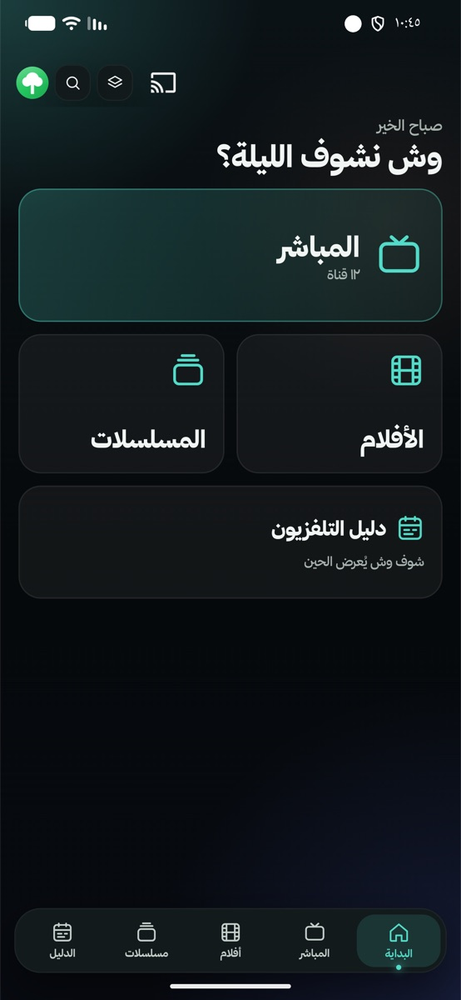

> Novix مشغّل فقط، وما فيه أي قنوات. تحتاج اشتراك أو قائمة تشغيل خاصة فيك.

## 📱 طريقة التثبيت

**١.** من الجوال افتح هذا الرابط:
**[تحميل Novix](https://github.com/ialaa-almehmadi/novix-mobile-releases/releases/latest/download/Novix.apk)**

**٢.** بعد ما يخلص التحميل، افتح الملف من إشعار التحميل أو من مجلد **التنزيلات**.

**٣.** أول مرة يقول لك الجوال إنه ما يسمح بتثبيت تطبيقات من المتصفح: اضغط **الإعدادات**، وفعّل **السماح من هذا المصدر**، وارجع.

**٤.** اضغط **تثبيت**. إذا طلعت رسالة **Google Play Protect**، اختر **مزيد من التفاصيل** ثم **التثبيت على أي حال**.

## 🚀 أول تشغيل

افتح Novix، واختر اللغة، واضغط **متابعة** لين توصل **إعداد Novix**:

- اختر **ملف شخصي جديد**، واكتب اسم، واختر صورة، ثم **إنشاء الملف الشخصي**.
- بعدها يطلب منك إضافة قائمة تشغيل: كمّل من الخطوة **٢** في القسم اللي تحت.

## ➕ إضافة مصدر M3U

**المسار:** المزيد (صورة ملفك فوق) ← الإعدادات ← المصادر ودليل البرامج ← قوائم التشغيل ← إضافة مصدر

**١.** في شاشة البداية اضغط على **صورة ملفك** فوق، ثم **الإعدادات**، ثم **المصادر ودليل البرامج**، ثم **قوائم التشغيل**، واضغط **إضافة مصدر**.

| | | | |
|:---:|:---:|:---:|:---:|
| 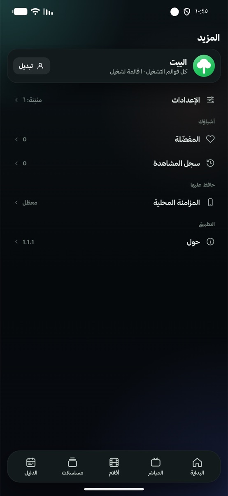 | 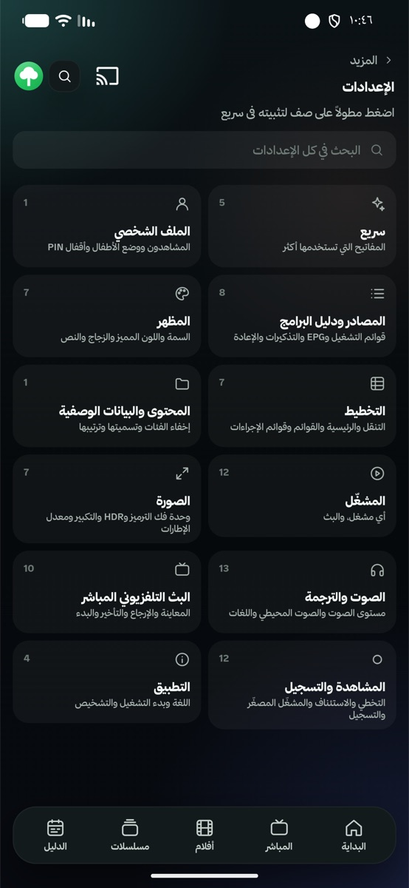 | 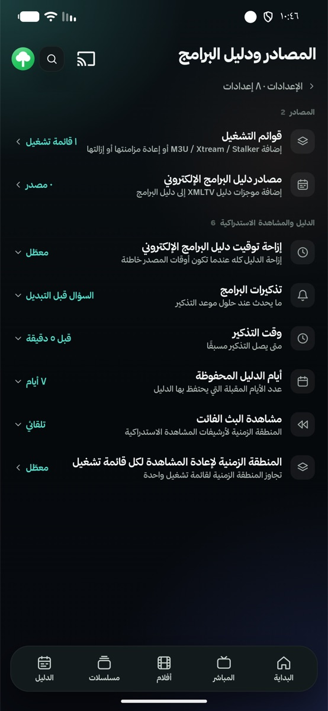 | 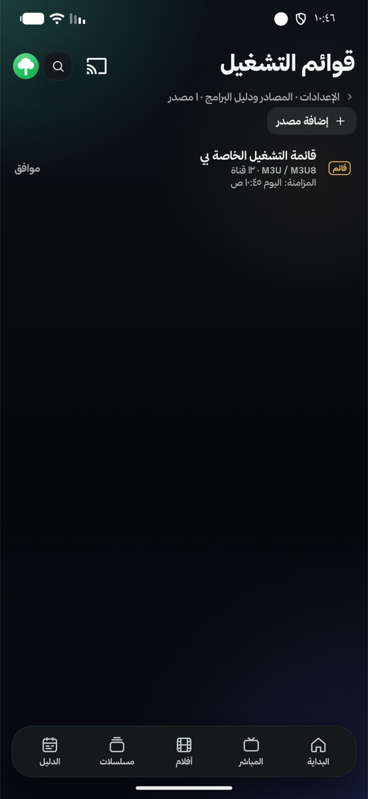 |
| الإعدادات | المصادر ودليل البرامج | قوائم التشغيل | إضافة مصدر |

**٢.** اختر **اكتب هنا**.

**٣.** فوق اختر **M3U / M3U8**، واضغط على **عنوان URL**.

**٤.** الصق رابط M3U، واضغط **حفظ**. وإذا تبي تسمّي المصدر، اكتب اسمه في **الاسم**.

| | | |
|:---:|:---:|:---:|
| 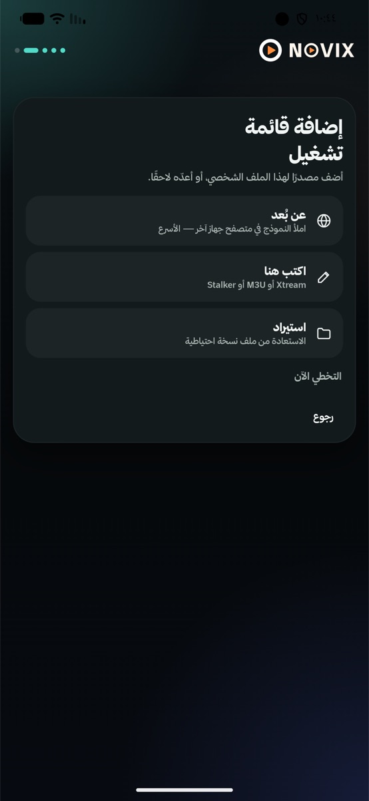 | 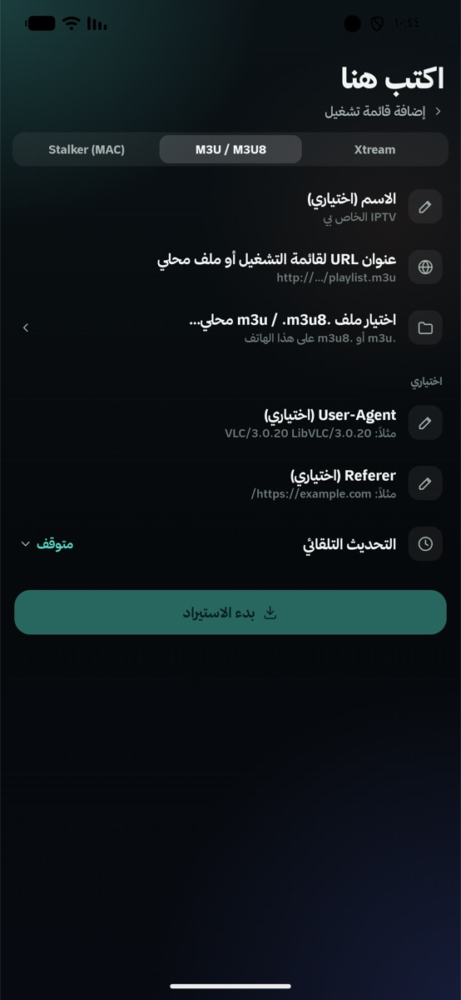 | 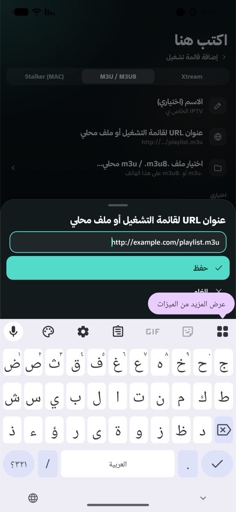 |
| ٢. اكتب هنا | ٣. M3U وعنوان URL | ٤. الصق الرابط |

**٥.** اضغط **بدء الاستيراد**، وانتظر لين يخلص. يطلع لك عدد القنوات.

**٦.** اضغط **متابعة**، وابدأ من **المباشر** في شاشة البداية.

| | | |
|:---:|:---:|:---:|
| 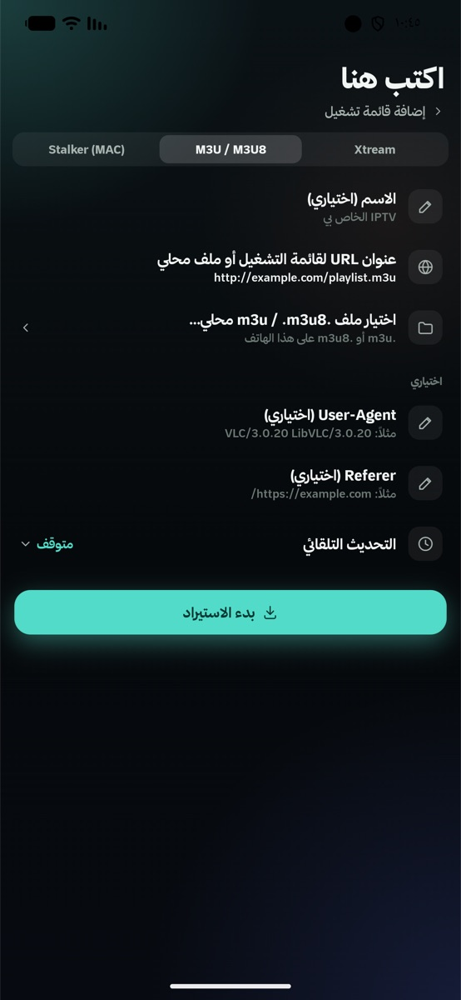 | 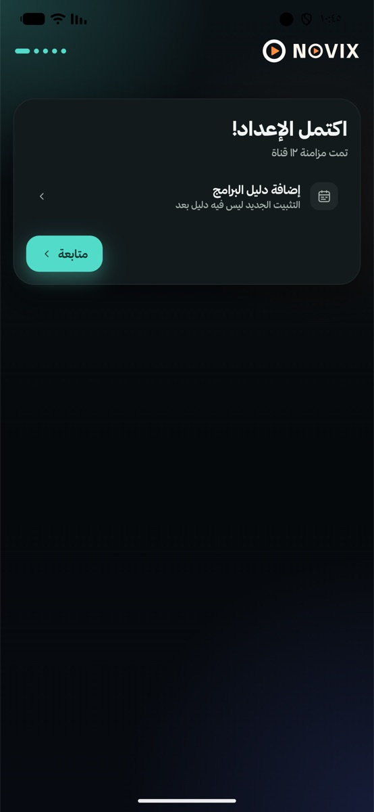 |  |
| ٥. بدء الاستيراد | اكتمل الإعداد | ٦. شاشة البداية |

> عندك اشتراك Xtream (رابط واسم مستخدم وكلمة مرور)؟ اختر **Xtream** في الخطوة ٣ بدل M3U.
> الرابط في الصور تجريبي.

## 🔄 التحديث

Novix يتحقق من التحديثات لحاله كل ما فتحته، وإذا فيه نسخة جديدة يطلع لك **تحديث التطبيق**.

وتقدر تتحقق بنفسك: **المزيد ← حول ← التحقق من وجود تحديثات**. إذا فيه نسخة جديدة اضغط **التحديث الآن**، ووافق على رسالة التثبيت. أول تحديث بس يطلب منك الجوال السماح لـ **Novix** بتثبيت التطبيقات: فعّله وارجع.

| | |
|:---:|:---:|
| 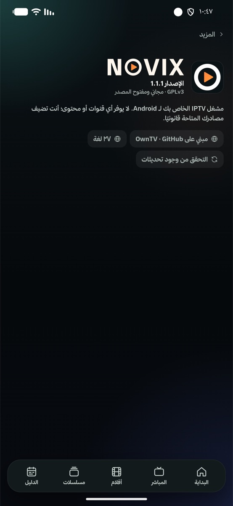 | 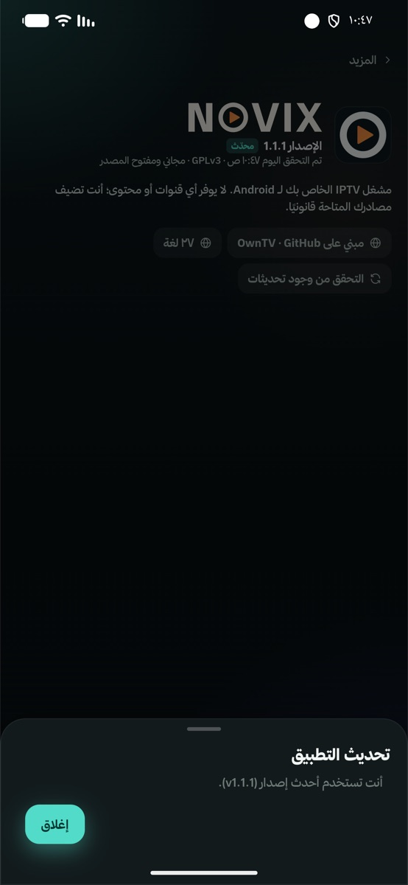 |
| حول ← التحقق من وجود تحديثات | النتيجة |

كل النسخ في صفحة [الإصدارات](https://github.com/ialaa-almehmadi/novix-mobile-releases/releases).

## 📄 الرخصة والكود

Novix للجوال مبني على [OwnTV Mobile](https://github.com/ahXN00/OwnTV_Mobile) ومكتبته [OwnTV Core](https://github.com/ahXN00/OwnTV_Core)، وكلها برخصة **GPL-3.0**.
الكود الكامل لكل نسخة مرفق في صفحة إصدارها (ملف `source`)، وتقدر تبنيه وتعدّله وتنشره بنفس الرخصة.

خط ثمانية من [font.thmanyah.com](https://font.thmanyah.com)، ومضمّن داخل التطبيق بس.

## 💬 تواصل

تطوير **علاء المحمادي** · X و TikTok: **[@alaa_mehmadi](https://x.com/alaa_mehmadi)**

